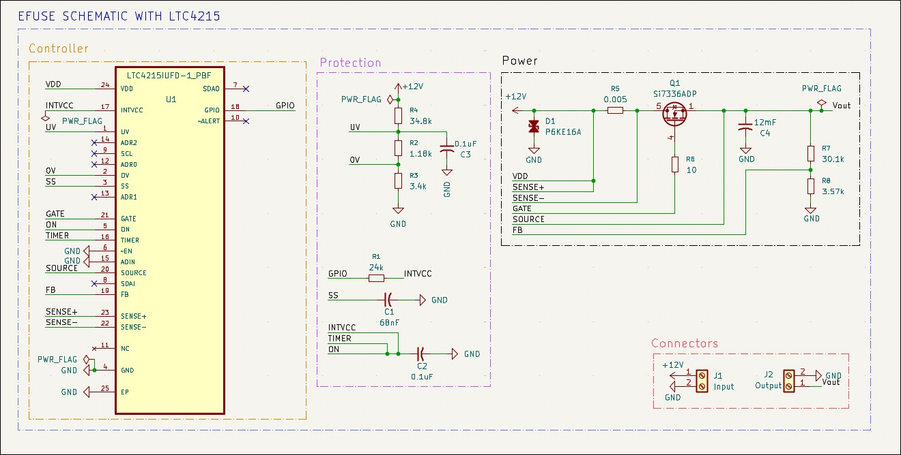
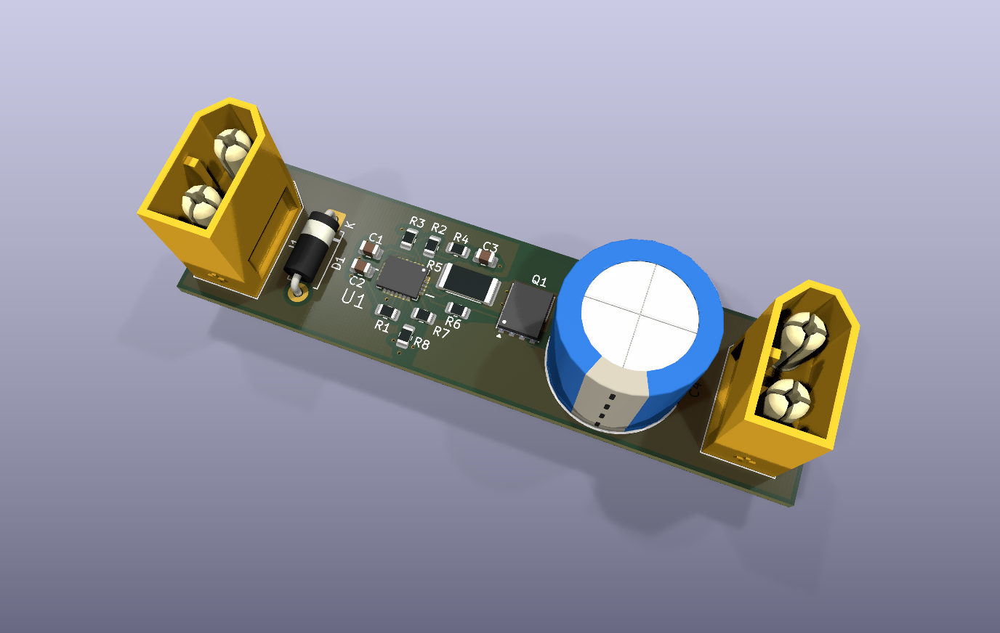
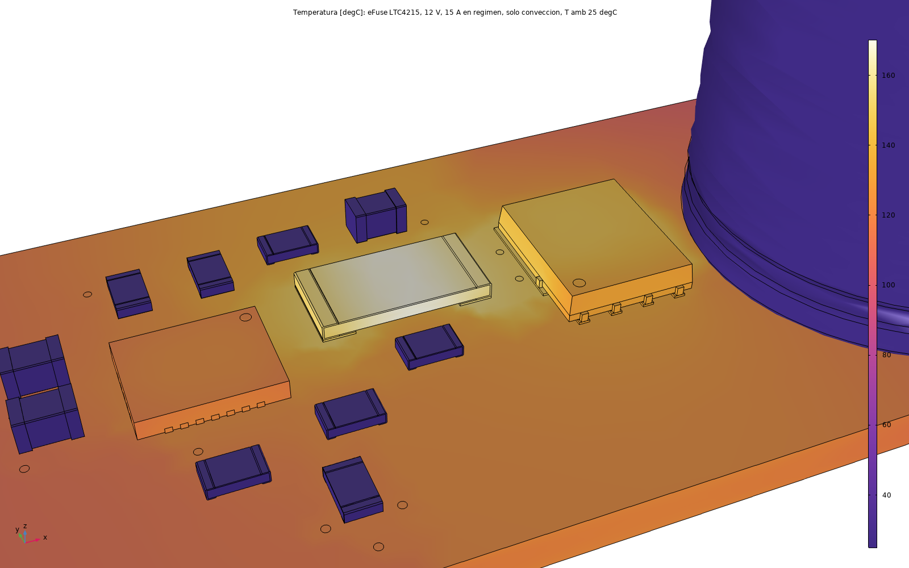

# Hot-Swap eFuse (LTC4215)

12 V hot-swap / electronic-fuse front-end built around the LTC4215 hot-swap controller, documented as an
honest engineering logbook: every result is marked as calculated, simulated, or pending — no invented
placeholders. A deliberately small, fast project in the same series as
[LM317-Adjustable-PowerSupply](https://github.com/IKGB105/LM317-Adjustable-PowerSupply) and the LM2596/VRM
projects — chosen to add a self-contained portfolio result without derailing the in-progress 2-phase VRM
work, while staying on-theme for a server/GPU power-delivery specialization (live board insertion, inrush
limiting, and electronic circuit breaking).

- **Input:** 12 V DC
- **Circuit breaker trip:** 5 A (fast, non-resettable — latches off, no auto-retry)
- **Steady-state current limit (electrical):** 15 A (post-startup foldback release)
- **UV/OV lockout:** ~10.6 V / ~14.3 V (auto-retry on both)

> ⚠️ **15 A continuous is not thermally safe in still air on this layout.** A coupled electrical-thermal
> COMSOL model (current flow in the copper solved together with the heat) found the copper pours
> themselves dissipate 1.6 W — as much as every component combined — pushing the sense resistor (R5) to
> 170 °C and the MOSFET junction to its 150 °C limit at 15 A with convection only. **12.5 A continuous is
> comfortable** (128 °C / 113 °C). See [Thermal FEM](#thermal-fem-comsol) below.

> ⚠️ **Simulation + PCB layout only, not built.** Confirmed as the project scope from the start (same as
> `VRM_2PHASE_LTC1929`). The schematic and PCB are complete and ERC/DRC-clean but have not been sent to
> fabrication.

<!--
PENDING: figure table (KiCad schematic, PCB 3D render) — export from KiCad and drop into
docs/figures/, then uncomment:

<table>
<tr>
<td><br><sub>KiCad — schematic</sub></td>
<td><br><sub>KiCad — PCB 3D render</sub></td>
</tr>
</table>
-->

## Key results (simulated, verified from the LTspice `.raw` file)

- **Controlled startup:** inrush current peaks at **5.2 A**, landing almost exactly on the calculated 5 A
  circuit-breaker target — confirms the soft-start (SS) ramp and $R_{SENSE}$ are sized consistently with
  the breaker threshold. $V_{OUT}$ reaches 12 V in ≈51 ms.
- **Automatic UV recovery:** a 12 V → 8 V dip triggers a fast (~300 µs) output sag (the MOSFET's body
  diode conducting, not active protection), then a full, unattended recovery — but only ~106–112 ms after
  $V_{DD}$ returns, because the LTC4215's internal startup-sequencer delay re-arms on every restart, not
  just the first power-up.
- **Permanent latch-off on a hard short:** the circuit breaker trips within the datasheet's 20 µs filter
  and the output stays at 0 V for the rest of the run — no auto-retry, by design (`ocautoretry=0`).

Two non-obvious simulation pitfalls (a flat-DC source masking the entire power-up transient, and the
100 ms internal startup delay looking like a dead circuit) are documented in the report so they aren't
re-discovered from scratch on a future project using this IC family.

## Repository structure

```
docs/         LaTeX report (efuse_ltc4215.tex) + the LTC4215 datasheet
kicad/        KiCad project — schematic + PCB, ERC/DRC clean
simulation/   LTspice schematic (EFuse.asc) — startup, UV auto-retry, and OC fault tests
fem/          COMSOL thermal FEM — script-generated model, results CSVs, figures
```

## Document

The full report (controller selection, datasheet review, component derivations, LTspice simulation
methodology and results, PCB layout decisions, debugging pitfalls found along the way) is in
[`docs/efuse_ltc4215.pdf`](docs/efuse_ltc4215.pdf) — compiled and committed. Source is
[`docs/efuse_ltc4215.tex`](docs/efuse_ltc4215.tex) if you want to edit or recompile it yourself
(`pdflatex`).

## Design

Topology and component values are adapted directly from the LTC4215 datasheet's own validated reference
circuit ("12V Application with 5A Circuit Breaker," Figure 1) — every UV/OV/FB threshold is independently
re-derived and numerically cross-checked against the datasheet's comparator thresholds, not copied
blindly. Full derivation, equations, and a discussion of the one component substitution needed for
simulation (TVS: BZX84C15L in place of the real BOM's P6KE16A, no local SPICE model for the latter) are in
the report.

## SPICE Simulation (LTspice)

In [`simulation/`](simulation/) — three scenarios validated against the `.raw` file: controlled startup
(soft-start ramp, inrush current), an undervoltage fault with automatic recovery, and a hard output short
with permanent latch-off. See the report for full waveform data and the two IC-specific debugging
pitfalls found along the way.

## PCB (KiCad)

In [`kicad/EFUSE/`](kicad/EFUSE/) — ERC and DRC both clean. Two-layer board (single ground domain, 15 A
doesn't justify more layers). Notable layout decisions, documented in full in the report:

- QFN-24 package required (not the smaller SSOP-16) because this design uses the OV protection pin, which
  the SSOP-16 doesn't expose.
- Kelvin connection at the current-sense resistor ($R_{SENSE}$, 2512 package): SENSE− routed as a
  dedicated low-current tap directly off the sense resistor's own pad, not off the high-current trace
  toward the MOSFET.
- Dedicated +12 V and SOURCE/$V_{OUT}$ copper pours (not just traces), sized for the 15 A steady-state
  current per IPC-2221; solid GND pour on the bottom layer with via-stitching (not via-in-pad, to avoid a
  solder-wicking risk) under the IC's exposed pad.
- All-SMD assembly except where physically impossible: the TVS (DO-15, no SMD option at 600 W peak pulse
  power), the 12 mF output capacitor (no ceramic SMD exists at that value), and the input/output
  connectors (AMASS XT60).

## Thermal FEM (COMSOL)

In [`fem/`](fem/) — *Heat Transfer in Solids*, natural convection, 25 °C ambient, no heatsink, at the
continuous 12 V/15 A operating point. Unlike the LM317/LM2596 projects, the current flow through the
copper pours is solved together with the heat (an *Electric Currents, Shell* model coupled both ways to
the thermal one), not neglected — this is what surfaced the 1.6 W of copper $I^2R$ loss that the earlier
hand estimate (≈0.9 W) missed by almost 2×. The whole model is built from a script
([`fem/codigo/termico_efuse.py`](fem/codigo/termico_efuse.py)) that reads vias directly from the
`.kicad_pcb`, so it regenerates if the board changes.

<br><sub>COMSOL — R5/Q1 close-up at 12V/15A, convection only, with thermal vias</sub>

**Key findings:**
- The sense resistor (R5), not the MOSFET, is the hottest part — same pattern as the LM2596 project, where
  the catch diode (not the regulator IC) turned out to be the real limit.
- Thermal vias added under R5/Q1 (stitched to a dedicated SENSE− copper island cut out of the ground pour
  — they can't go straight to GND without shorting) lower both by ≈10 °C, but the bigger issue is the total
  heat on a small board, not just how it escapes R5/Q1.
- 15 A continuous: R5 at 170 °C, Q1's junction at its 150 °C rated limit (convection only). With radiation
  (realistic for a solder-masked board): 112–124 °C on Q1, 133–141 °C on R5 — within limits but little
  margin.
- To reach 15 A continuous safely: 2 oz copper (halves the pour loss), wider/shorter pours, a
  higher-rated metal-strip R5, or airflow — documented as pending, not implemented.

## License

MIT — see [LICENSE](LICENSE).
